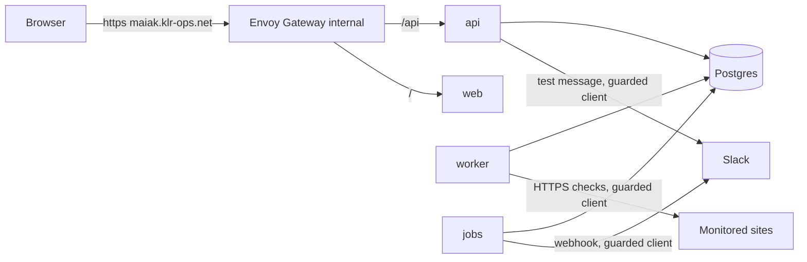

# Architecture overview

Maiak is a **modular monolith deployed as several processes** from one Go module and one image. It is a hosted multi-tenant SaaS: a central control plane (api, database, scheduler, incident logic, alerting) and execution points (probes) that run checks. Today there is one execution point, the in-cluster `worker`.

## Processes

| Process | Responsibility | DB role | Scaling |
|---|---|---|---|
| `api` (`cmd/api`) | REST for the web app: auth, monitors, Slack settings and test message, dashboard read models. Upserts the admin from `MAIAK_ADMIN_*` at start | `maiak_api` | stateless, replicas by load |
| `worker` (`cmd/worker`) | Claims due (monitor, location) jobs every second, runs HTTPS checks through the SSRF guard, writes result, schedule, incident state and outbox in one transaction per tenant batch. Calls `ensure_partitions()` at start and hourly | `maiak_worker` | replicas (limits are per process, R-030) |
| `jobs` (`cmd/jobs`) | Outbox delivery to Slack (retries, per-channel rate limit) and singleton housekeeping under advisory locks: partitions (daily), rollups (5 min), retention (daily), expired-session purge (hourly) | `maiak_worker` | 1+ replicas (R-060, L-082) |
| `migrate` (`cmd/migrate`) | Applies migrations (ArgoCD Sync hook Job, wave -1, ADR-0013) | `maiak_owner` | one-shot Job |
| `maiakctl` (`cmd/maiakctl`) | Admin CLI: `hashpw`, `db bootstrap` (also the hook Job `maiak-db-bootstrap`, wave -3, ADR-0014) | RDS admin login | local / one-shot Job |
| `web` | Static React SPA served by nginx | none | 1-2 replicas |
| Postgres | Only datastore (database `maiak` in RDS) | | external |

Every process serves `/healthz`, `/readyz` and `/metrics` on the admin port (`:9090`, never routed externally); metrics and log fields are listed in the [observability runbook](../runbooks/observability.md).

Later: `probe` (remote executor, no DB access, pull/push over HTTPS), `agent` (inside a client cluster), a status-page renderer, ClickHouse for results.



## Backend modules (`backend/internal`)

| Module | Responsibility | Owns tables |
|---|---|---|
| `tenants` | tenant rows and limits | `tenants` |
| `auth` | admin bootstrap, login/logout, sessions, CSRF, login rate limit | `users`, `memberships`, `auth_identities`, `sessions` |
| `monitors` | monitor definition and validation, lifecycle (pause, resume, URL change, soft delete), location assignment | `monitors`, `monitor_locations`, `monitor_state` (the incident state machine updates it inside the result transaction) |
| `scheduler` | claims and leases, schedule resets, home location | `monitor_location_state`, `probe_locations` |
| `safehttp` | SSRF guard: guarded `http.Client` for the prober and the Slack notifier | none |
| `checks` | HTTPS check (`Prober` seam) | none |
| `worker` | the worker loop: limits, batching, result transactions | none |
| `results` | result inserts and latency buckets; rollups are computed by the `compute_rollups` function | `check_results`, `result_rollups_hourly` |
| `incidents` | state machine (`incidents/machine`, pure), incident open/resolve, outbox rows | `incidents`, `incident_monitors`, `notification_deliveries` (outcomes are recorded by `jobs` through `finish_delivery`) |
| `notify` | Slack channel settings (encrypted), message formats, Slack notifier | `notification_channels`, `monitor_channels` |
| `jobs` | outbox delivery loop (`Notifier` seam) and housekeeping | none |
| `audit` | audit log rows | `audit_log` |
| `queries` | read models for the dashboard (cross-table SELECT only) | none |
| `api` | HTTP layer generated from `api/openapi.yaml`, error mapping | none |
| `dbbootstrap` | database and role bootstrap used by `maiakctl` and tests | none |
| `platform` | config, `WithTenantTx`/`WithTx`, logging, metrics, crypto, clock, httpx, uuidv7 | none |
| `e2e` | end-to-end test only (`-tags maiaktest`, ADR-0080) | none |

Rule: a table is written only through its owning module (owners as declared in the migrations). `queries` may join across tables for reads. Seams that exist in code: `checks.Prober` (consumed by `worker`), `jobs.Notifier` (implemented by `notify.SlackNotifier`), `notify.Doer` (the HTTP client), `safehttp.Resolver`. The `JobSource`/`ResultSink` seams of ADR-0006 are not implemented yet: the worker calls `scheduler` and `results` directly; they come with the remote probe (L-006).

## Flows

### Life of a check
```
worker  -> claim_due_monitors(n, location)   lease on (monitor, location), skips paused/deleted monitors and inactive tenants
        -> checks.Prober (safehttp client)   resolve, validate every address, dial the validated IP on 443, TLS, status, latency, cert expiry
        -> one tenant transaction (lock_timeout 2 s):
             results.Insert                  check_results row
             scheduler.Complete              lease check (stale -> discard), next_run_at
             incidents.ApplyResult           location and monitor state; open/resolve incident;
                                             notification_deliveries row when Slack is active (SAME transaction)
jobs    -> claim_deliveries(n)               oldest first per monitor, claim token, lease 2 min
        -> notify.Format + SlackNotifier     guarded client, no redirects
        -> finish_delivery(id, token, ...)   sent / retry with backoff / failed after 5 attempts
web     -> GET /api/v1/...                   api reads through internal/queries (monitor_state, results, rollups, incidents)
```

### Monitor lifecycle (api)
Create inserts the monitor, its home location and the initial state rows in one transaction (limit checked under a tenant row lock). Pause, resume and a URL change call `reset_monitor_runtime(monitor_id)` (schedule back to unknown, lease dropped, next run within 30 s) and reset `monitor_state`; pause, delete and a URL change resolve an open incident without a notification (ADR-0016, ADR-0018).

### Who calls which database function
| Caller | Functions |
|---|---|
| api | `auth_lookup_session`, `reset_monitor_runtime` |
| worker | `claim_due_monitors`, `ensure_partitions` |
| jobs | `claim_deliveries`, `finish_delivery`, `outbox_pending`, `ensure_partitions`, `compute_rollups_catch_up`, `list_droppable_partitions`, `detach_expired_partition`, `drop_detached_partition`, `purge_expired_sessions` |

Grantees and purposes are in the [data model](data-model.md#security-definer-functions).

## Locations and probes

A location is a (region x network/provider) pair. Every check runs per (monitor, location) with the full interval. A remote probe will never connect to the database: it will call the api (`claim`, `results`) over HTTPS with a per-location token, initiating all connections (ADR-0006, not implemented). The in-cluster `agent` for client clusters will use the same protocol. Today the only location is `home-eu-central-1`, served by the worker (`MAIAK_WORKER_LOCATION`).

## Verification status
Everything above is implemented and covered by unit and integration tests run locally against PostgreSQL 16 (CI uses 15, R-011), including the end-to-end test of ADR-0080. None of it has run in CI or in the cluster yet: see the slice table in [PROJECT.md](../PROJECT.md).

## Cross-cutting

- Tenancy and RLS: [ADR-0004](../adr/0004-tenancy-rls.md), [data model](data-model.md).
- API contract and same-origin routing: [ADR-0008](../adr/0008-api-contract.md), [ADR-0017](../adr/0017-api-contract-conventions.md).
- SSRF defence: [ADR-0011](../adr/0011-ssrf-defence.md), amended by [ADR-0016](../adr/0016-mvp-semantics.md) and [ADR-0018](../adr/0018-review-fixes-b05-b09.md); test route [ADR-0080](../adr/0080-e2e-test-through-the-guard.md).
- Worker and jobs: [ADR-0020](../adr/0020-worker-scheduling-and-limits.md), [ADR-0051](../adr/0051-jobs-delivery-and-housekeeping.md), [ADR-0060](../adr/0060-review-fixes-b10-b12-implementation.md).
- Deployment: [ADR-0010](../adr/0010-deployment.md). Scale path: [ADR-0012](../adr/0012-scale-path.md).
