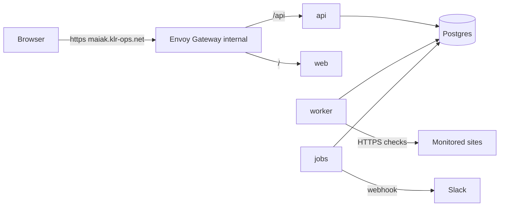

# Architecture overview

Maiak is a **modular monolith deployed as several processes** from one Go module and one image. It is a hosted multi-tenant SaaS: a central control plane (api, database, scheduler, incident logic, alerting) and execution points (probes) that run checks. Today there is one execution point, the in-cluster `worker`.

## Processes

| Process | Responsibility | Scaling |
|---|---|---|
| `api` | REST for the web app (auth, monitors, channels, history, incidents, dashboard queries). Later also the probe endpoints (`claim`, `results`) | stateless, replicas by load |
| `worker` | Claims due checks, runs HTTPS probes, hands results to the results/incidents modules. Home location, talks to the DB directly | replicas |
| `jobs` | Housekeeping: partition creation, hourly rollups, retention, **notification delivery from the outbox** | 1+ replicas; singleton tasks under a Postgres advisory lock |
| `migrate` | Applies migrations as the owner role (ArgoCD PreSync hook) | one-shot Job |
| `maiakctl` | Admin CLI (for example `hashpw`) | local |
| `web` | Static React SPA served by nginx | 1-2 replicas |
| Postgres | Only datastore (database `maiak` in RDS) | external |

Later: `probe` (remote executor, no DB access, pull/push over HTTPS), `agent` (inside a client cluster), a status-page renderer, ClickHouse for results.



## Backend modules (`backend/internal`)

| Module | Responsibility | Owns tables |
|---|---|---|
| `tenants` | tenants, limits | `tenants` |
| `auth` | admin bootstrap from Secret, sessions, CSRF, rate limit, users and roles | `users`, `memberships`, `auth_identities`, `sessions` |
| `monitors` | monitor definition, validation, location assignment | `monitors`, `probe_locations`, `monitor_locations` |
| `scheduler` | due selection, leases, fairness, per-tenant and per-host limits | `monitor_location_state` |
| `checks` | executes the check (`Prober` seam) plus the SSRF guard | none |
| `results` | result storage, rollups, chart queries (`ResultSink` seam) | `check_results`, `result_rollups_hourly` |
| `incidents` | state machine per location, quorum, open/resolve incident | `monitor_state`, `incidents`, `incident_monitors` |
| `notify` | channels (Slack webhook, encrypted), message formatting, retries, rate limits (`Notifier` seam) | `notification_channels`, `monitor_channels`, `notification_deliveries` |
| `audit` | audit log | `audit_log` |
| `queries` | read models for the dashboard (cross-table SELECT only) | none |
| `platform` | `WithTenantTx`, config, logging, crypto, clock, metrics, uuidv7 | none |

Rule: a table is written only through its owning module. `queries` may join across tables for reads.

## Life of a check

```
worker  -> claim_due_monitors(n)        lease on (monitor, location)
        -> checks.Prober                SSRF guard, HTTPS, status/latency/TLS expiry
        -> results.ResultSink           check_results + monitor_location_state
        -> incidents                    recompute monitor status by quorum
             on up<->down: incident + notification_deliveries row, SAME transaction
jobs    -> notification_deliveries (SKIP LOCKED) -> Slack -> delivery status, retries
web     -> GET /api/v1/...              api reads monitor_state, rollups, incidents
```

## Locations and probes

A location is a (region x network/provider) pair. Every check runs per (monitor, location) with the full interval. A remote probe never connects to the database: it calls the api (`claim`, `results`) over HTTPS with a per-location token, initiating all connections. The in-cluster `agent` for client clusters uses the same protocol. The home `worker` talks to the DB through local implementations of `JobSource` and `ResultSink`. See ADR-0006.

## Cross-cutting

- Tenancy and RLS: [ADR-0004](../adr/0004-tenancy-rls.md), [data model](data-model.md).
- API contract and same-origin routing: [ADR-0008](../adr/0008-api-contract.md).
- SSRF defence: [ADR-0011](../adr/0011-ssrf-defence.md).
- Deployment: [ADR-0010](../adr/0010-deployment.md).
- Scale path: [ADR-0012](../adr/0012-scale-path.md).
